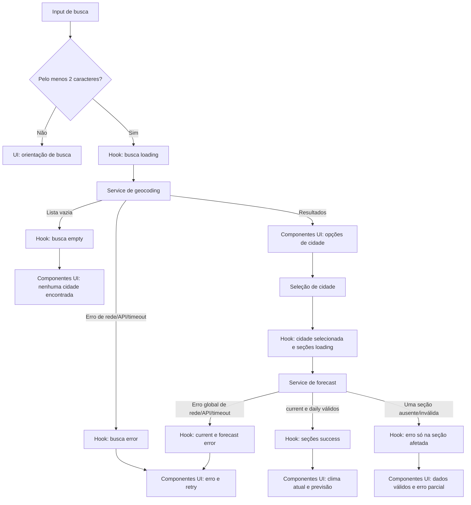

# Plano Técnico — Weather App

## Architecture

Aplicação web client-side de página única, sem backend próprio. A arquitetura separa quatro responsabilidades: componentes apresentam dados e encaminham ações; hooks orquestram estado e operações; serviços fazem I/O com a Open-Meteo; `lib/` contém transformações puras. `types/` define os contratos compartilhados entre as camadas.

```text
components -> hooks/useWeather -> services/openMeteo -> Open-Meteo Geocoding / Forecast
                    |                  |
                    +------ lib/ <-----+
                    +------ types/ -----+
```

- **components:** recebem modelos de domínio e callbacks; não chamam `fetch`, não interpretam JSON externo e não mantêm estado compartilhado do fluxo.
- **hooks:** coordenam busca, seleção, unidade, loading/erro/vazio, retry e descarte de respostas obsoletas; dependem do contrato do serviço, não dos detalhes HTTP.
- **services:** montam URLs, executam `fetch`, timeout e tratamento de falhas de transporte; delegam validação e mapeamento de payloads às funções de `lib/` e retornam tipos de domínio.
- **lib:** implementa funções puras para converter respostas desconhecidas da API, mapear códigos WMO, tratar datas/fusos e formatar ou converter temperaturas. Não acessa rede, DOM ou estado React.
- **types:** declara `City`, `CurrentWeather`, `ForecastDay`, `WeatherData`, `Unit` e contratos de resultado/erro usados entre camadas.

Não adicionar cache persistente, autenticação, armazenamento local, biblioteca de estado global ou camada de proxy. Revisar essa decisão se termos, cotas ou políticas do provedor exigirem backend ou outra fonte. A aprovação dos termos e da atribuição da Open-Meteo é gate de release, conforme a spec.

## Tech Stack

- TypeScript strict, React 19 e Vite 8, conforme `package.json`.
- Tailwind CSS para estilos, seguindo as instruções do projeto.
- `fetch`, `URLSearchParams` e `AbortController` nativos para chamadas HTTP e timeout; sem cliente HTTP adicional.
- Vitest e Testing Library para testes unitários e de componentes; Playwright para E2E.
- Biome para lint e formatação.
- pnpm para instalação e scripts.

Não introduzir dependências adicionais sem necessidade comprovada. A camada de dados retorna modelos do domínio e não expõe tipos do provedor aos componentes.

## Project Structure

```text
src/
  App.tsx
  components/
    CitySearch.tsx
    CurrentWeather.tsx
    DailyForecast.tsx
    UnitSelector.tsx
    QueryFeedback.tsx
  hooks/
    useWeather.ts
  services/
    openMeteo.ts
  types/
    weather.ts
  lib/
    mapOpenMeteo.ts
    weatherCodes.ts
    temperature.ts
    date.ts
tests/
  unit/
    openMeteo.test.ts
    temperature.test.ts
    date.test.ts
  components/
  e2e/
    weather-app.spec.ts
```

Manter um componente por arquivo. `App.tsx` compõe a tela; componentes focam em apresentação; `useWeather` coordena o fluxo; `openMeteo.ts` concentra o acesso HTTP; `mapOpenMeteo.ts`, `weatherCodes.ts`, `temperature.ts` e `date.ts` são funções puras; `types/weather.ts` é a fonte dos contratos do domínio. Criar apenas os diretórios e arquivos necessários ao implementar cada fatia.

Essa separação reduz o custo dos testes: componentes podem ser testados com props e callbacks sem rede; o hook pode receber um serviço falso para testar loading, retry e concorrência; o serviço pode testar URL, timeout e erros com `fetch` mockado; `lib/` pode ser testado com entradas e saídas determinísticas, incluindo payloads parciais e datas/fusos fixos. Os testes de cada camada não precisam iniciar as camadas abaixo dela.

## Data Model

Modelos internos usam temperatura em Celsius para evitar estado duplicado; a unidade de apresentação é aplicada na formatação. Coordenadas identificam a localização selecionada.

```ts
export type Unit = "celsius" | "fahrenheit";

export interface City {
  id: number | null;
  name: string;
  admin1: string | null;
  country: string | null;
  latitude: number;
  longitude: number;
}

export interface CurrentWeather {
  temperatureC: number | null;
  apparentTemperatureC: number | null;
  weatherCode: number | null;
  relativeHumidityPercent: number | null;
  windSpeedKmh: number | null;
  observedAt: string | null;
}

export interface ForecastDay {
  localDate: string;
  availability: "available" | "unavailable";
  weatherCode: number | null;
  minimumTemperatureC: number | null;
  maximumTemperatureC: number | null;
  precipitationProbabilityPercent: number | null;
}

export interface WeatherData {
  timezone: string;
  timezoneSource: "provider" | "utc-fallback";
  current: SectionResult<CurrentWeather>;
  forecast: SectionResult<ForecastDay[]>;
}

export type SectionResult<T> =
  | { status: "success"; data: T }
  | { status: "error"; error: WeatherError };

export type WeatherSection = "current" | "forecast";

export interface WeatherRequest {
  city: City;
  section?: WeatherSection;
}

export interface CitySearchRequest {
  query: string;
}

export interface WeatherError {
  kind: "network" | "http" | "timeout" | "invalid-response";
}
```

`City.id` usa o identificador do geocoder quando fornecido; coordenadas identificam a seleção e podem servir como fallback de chave. Respostas externas são `unknown` até validação e mapeamento. Campos de dados ausentes viram `null`, nunca zero. A unidade de velocidade do vento foi aprovada como km/h em 27/10/2026; `windSpeedKmh` e a API usam km/h. `weatherCode` é convertido para descrição pt-BR por uma tabela WMO/Open-Meteo; código desconhecido resulta em condição indisponível, sem falhar o restante do painel.

Contratos de serviço:

```ts
export interface OpenMeteoService {
  searchCities(request: CitySearchRequest, signal?: AbortSignal): Promise<City[]>;
  getWeather(request: WeatherRequest, signal?: AbortSignal): Promise<WeatherData>;
}

export type Resource<T> =
  | { status: "idle" }
  | { status: "loading" }
  | { status: "success"; data: T }
  | { status: "empty" }
  | { status: "error"; error: WeatherError };

```

`WeatherData.current` e `WeatherData.forecast` são resultados independentes: formato inválido de um conjunto presente marca erro somente nessa seção. Antes do mapeamento, o serviço rejeita `current` ou `daily` ausente ou `null` com `WeatherServiceError` de tipo `invalid-response`; erro de transporte ou JSON inválido também invalida a operação. Campos individuais ausentes continuam `null`; probabilidade de precipitação explicitamente `null` vira `0`. A previsão sempre contém cinco posições, de hoje a hoje + quatro no fuso aplicado; datas sem dados usam `availability: "unavailable"`, preservando a posição. `Resource<T>` pertence à camada de UI, não ao contrato HTTP. A propriedade `section` limita a atualização à seção solicitada durante retry; como a API Forecast entrega ambas no mesmo endpoint, a chamada pode receber os dois conjuntos, mas a UI preserva a seção válida já exibida.

## Data Flow

1. A pessoa envia a busca por Enter ou pelo botão. `SearchBar` aplica trim, mostra a orientação para menos de dois caracteres e chama `onSearch(query)` somente com um termo válido. `App` encaminha esse termo ao hook.
2. `useWeather` marca a busca como loading e chama `searchCities`; resultados são convertidos em `City` e apresentados com cidade, região quando disponível e país.
3. Ao selecionar uma localização, a UI atualiza a seleção imediatamente, limpa os resultados de busca e inicia a consulta de clima para suas coordenadas.
4. `getWeather` solicita clima atual e previsão diária na mesma resposta Forecast API; o mapper valida cada seção separadamente e normaliza as cinco datas no timezone retornado ou em UTC.
5. A UI mantém estados `Resource` independentes para clima atual e previsão. Falha de uma seção não oculta a outra. `temperature.ts` converte de Celsius para a unidade selecionada e arredonda para uma casa decimal com `Intl.NumberFormat("pt-BR")`.
6. Cada busca/seleção recebe um identificador crescente. Respostas de identificadores antigos são descartadas; a seleção mais recente é a única que pode atualizar a tela.
7. Retry repete a última busca válida ou consulta da localização selecionada, sem repetir automaticamente. Retry de clima mantém a localização e atualiza somente a seção com erro.



## External APIs

**Open-Meteo Geocoding API**

- URL: `https://geocoding-api.open-meteo.com/v1/search?name=Lisbon&count=10&language=pt&format=json`. Construir os parâmetros com `URLSearchParams`; `name` recebe a busca aparada. `current`, `daily` e `timezone` não se aplicam a este endpoint.
- Parâmetros relevantes: `name` (obrigatório), `count=10` (limite de resultados), `language=pt` (nomes em português quando disponíveis) e `format=json`.
- Exemplo resumido:

```json
{
  "results": [
    {
      "id": 2267057,
      "name": "Lisbon",
      "latitude": 38.7167,
      "longitude": -9.1333,
      "admin1": "Lisbon",
      "country": "Portugal"
    }
  ]
}
```

- Mapeamento: cada item de `results` vira `City`: `id`, `name`, `admin1`, `country`, `latitude` e `longitude` mantêm seus significados; campos opcionais ausentes viram `null`. O item selecionado é enviado ao forecast pelas coordenadas, não pelo nome. Lista ausente ou vazia vira estado `empty`; falha HTTP, rede, timeout ou JSON inválido vira `error`.

**Open-Meteo Forecast API**

- URL: `https://api.open-meteo.com/v1/forecast?latitude=38.7167&longitude=-9.1333&current=temperature_2m,apparent_temperature,relative_humidity_2m,weather_code,wind_speed_10m&daily=weather_code,temperature_2m_min,temperature_2m_max,precipitation_probability_max&temperature_unit=celsius&wind_speed_unit=kmh&timezone=auto&forecast_days=5`. Codificar os parâmetros com `URLSearchParams`.
- Parâmetros relevantes: `latitude` e `longitude` da `City` selecionada; `current` seleciona os campos meteorológicos atuais; `daily` seleciona os campos diários; `timezone=auto` solicita o fuso das coordenadas; `forecast_days=5` solicita hoje e os quatro dias seguintes. `temperature_unit=celsius` mantém o modelo em Celsius e `wind_speed_unit=kmh` define a unidade da velocidade do vento.
- Exemplo resumido (as listas diárias reais contêm cinco elementos):

```json
{
  "timezone": "Europe/Lisbon",
  "current": {
    "time": "2026-10-27T12:00",
    "temperature_2m": 18.4,
    "apparent_temperature": 18.0,
    "relative_humidity_2m": 72,
    "weather_code": 3,
    "wind_speed_10m": 12.3
  },
  "daily": {
    "time": ["2026-10-27", "2026-10-28", "2026-10-29", "2026-10-30", "2026-10-31"],
    "weather_code": [3, 61, 2, 0, 3],
    "temperature_2m_min": [15.1, 14.8, 14.0, 13.7, 14.2],
    "temperature_2m_max": [20.4, 19.2, 21.0, 21.8, 20.1],
    "precipitation_probability_max": [10, 70, 20, 0, 10]
  }
}
```

- Mapeamento: `timezone` e a origem do fuso preenchem `WeatherData`; se `timezone` faltar, usar `UTC` e `timezoneSource: "utc-fallback"`. `current.time`, `temperature_2m`, `apparent_temperature`, `weather_code`, `relative_humidity_2m` e `wind_speed_10m` viram `observedAt`, `temperatureC`, `apparentTemperatureC`, `weatherCode`, `relativeHumidityPercent` e `windSpeedKmh` de `CurrentWeather`. Para `ForecastDay`, associar por índice de `daily.time`: `weather_code`, `temperature_2m_min`, `temperature_2m_max` e `precipitation_probability_max` viram `weatherCode`, `minimumTemperatureC`, `maximumTemperatureC` e `precipitationProbabilityPercent`; cada data esperada recebe `availability: "available"` ou, se ausente, `"unavailable"`.
- O serviço exige `current` e `daily` não nulos antes de chamar o mapper. Validar o formato dos blocos presentes separadamente e representá-los como `SectionResult` independentes. Campos individuais ausentes viram `null`, exceto precipitação explicitamente `null`, que vira `0`. Associar as datas pelo valor de `daily.time`, mantendo cinco posições na ordem esperada.
- Não persistir coordenadas, consultas nem respostas. A ausência de API key não elimina a necessidade de validar uso, atribuição, cobertura e limites para produção.

## State Management

O estado da aplicação vive localmente no hook `useWeather`, sem estado global ou persistência. Ele mantém a consulta digitada, `Resource<City[]>` para geocoding, cidade selecionada, `Resource<CurrentWeather>` e `Resource<ForecastDay[]>` independentes e a unidade `Unit`. A unidade inicial é `celsius`; cidade e unidade existem somente até a recarga.

Cada recurso usa os estados explícitos `idle`, `loading`, `success`, `error` e `empty`. Busca começa em `idle`; envio válido muda para `loading`, depois para `success` com resultados ou `empty` quando não há cidades. Selecionar uma cidade inicia `loading` para current e forecast; sucesso e erro são independentes por seção. `empty` é usado para busca sem resultados, não para falhas nem para seção meteorológica ausente. Ao trocar de cidade, limpar os dados da seleção anterior para não associá-los ao novo cabeçalho; ao repetir apenas uma seção, preservar a outra seção válida. Campo meteorológico individual ausente usa `null`; dia sem dados mantém seu slot com `availability: "unavailable"`.

Os dados meteorológicos permanecem em Celsius no modelo. A renderização deriva cada valor conforme `Unit`: para Fahrenheit, `valueC * 9 / 5 + 32`; para Celsius, usa `valueC` sem conversão. Arredondar e formatar a uma casa decimal com `Intl.NumberFormat("pt-BR")`. A troca de unidade altera somente `Unit` e a apresentação; não modifica os dados, não chama serviços e não dispara novo request.

Usar identificadores de request ou cancelamento com `AbortController` para ignorar respostas obsoletas após buscas/seleções rápidas. Loading e resultado são anunciados conforme AC-07. Não usar Context, Redux, React Query ou persistência: há uma tela, sem estado compartilhado entre rotas ou consumidores.

## Error Handling

- **Validação local:** consulta com menos de dois caracteres após trim não faz request; manter o texto e mostrar a orientação da spec. Não tratar como erro de rede.
- **Sem resultados:** geocoding bem-sucedido com lista vazia termina em `empty` e mostra “Nenhuma cidade encontrada.”; não consultar forecast.
- **Rede:** rejeição de `fetch` (exceto cancelamento intencional de request obsoleto) termina em `error` com `kind: "network"`.
- **Erro da API:** resposta HTTP não bem-sucedida termina em `error` com `kind: "http"`; não converter em lista vazia.
- **Timeout:** cada request é abortado após 10 s, incluindo a leitura do corpo JSON, e termina em `error` com `kind: "timeout"`. Exibir o limite de dez segundos na mensagem de falha e “Tentar novamente”. Cancelamento por nova operação ou desmontagem não é timeout nem erro visível.
- **Resposta inválida:** falha ao interpretar JSON ou estrutura incompatível termina em `error` com `kind: "invalid-response"`. Erro de transporte/API invalida a operação inteira; para Forecast, falha global afeta current e forecast.
- **Resposta parcial:** campo individual ausente vira `null` e é apresentado como “Não disponível.”; precipitação explicitamente `null` vira `0`. Dia ausente conserva sua posição com `availability: "unavailable"`. Bloco `current` ou `daily` ausente ou `null` causa `WeatherServiceError` de tipo `invalid-response`. Formato inválido de um bloco presente afeta somente sua seção; a outra seção válida permanece visível.
- **Retry:** repetir manualmente a última busca válida ou a consulta da cidade selecionada; registrar também cidade e seção da última tentativa parcial para que o retry genérico preserve essa operação. Retry meteorológico atualiza somente a seção com erro e preserva a seção válida. Não repetir automaticamente.
- **Mensagens:** manter “Não foi possível carregar os dados.” com orientação amigável por tipo de falha: verificar conexão, serviço indisponível, limite de dez segundos ou resposta inválida. Preservar `kind` e status HTTP para diagnóstico, sem expor jargão HTTP na mensagem.
- **Concorrência:** descartar respostas e erros de requests cancelados/obsoletos; somente a busca ou seleção mais recente pode atualizar a tela.
- Anunciar loading e erro a tecnologias assistivas conforme AC-07/AC-09 e usar a mensagem de erro definida na spec.

## Testing Strategy

- **Vitest — funções puras (`lib/`):** testar conversão Celsius/Fahrenheit e arredondamento/formatting pt-BR; descrição de códigos WMO; parsing/mapeamento de payloads; datas locais, virada de dia e fallback UTC; campos e dias ausentes sem perda de posição. Fixar relógio e fuso nos testes de data.
- **Vitest — serviços (`services/`):** mockar `fetch` para verificar URLs e parâmetros, encoding de acentos, mapeamento de respostas, lista vazia, HTTP não OK, rejeição de rede, JSON/payload inválido, timeout e sinal de abort. Verificar precipitação `null` como `0`, rejeição de blocos `current`/`daily` ausentes ou nulos e isolamento de erros de formato nos blocos presentes.
- **Rede offline:** simular rejeição de `fetch` e interrupção durante a leitura do corpo; testar timeout antes e depois dos cabeçalhos com relógio falso. No Playwright, abortar as rotas da API com `internetdisconnected`, depois responder com fixtures e verificar que “Tentar novamente” repete a URL da busca ou as coordenadas selecionadas sem redigitação.
- **Vitest + Testing Library — hooks/componentes:** testar busca e seleção com serviço falso; estados `idle`, `loading`, `success`, `empty` e `error`; validação de input, mensagens, retry, unidade sem novo request, dados parciais e anúncios acessíveis. Usar promises adiadas para confirmar que resposta antiga não substitui seleção recente; usar relógio falso para timeout.
- **Playwright — E2E:** interceptar as rotas Open-Meteo para testar o fluxo completo de busca, seleção por coordenadas, exibição atual/diária, erro e retry, dados parciais e troca de unidade sem uma nova chamada de rede. Cobrir teclado e viewports de 320, 375, 768 e 1280 px, verificando ausência de rolagem horizontal.
- **Performance:** executar o cenário de NFR-03 em 100 execuções com latência e respostas simuladas para resultados reproduzíveis. Medir disponibilidade do shell separadamente da API externa conforme NFR-05.
- **Release checks:** `pnpm lint`, `pnpm build`, `pnpm test` e `pnpm test:e2e`; combinar verificações automatizadas de acessibilidade com revisão manual por teclado e leitor de tela para WCAG 2.2 AA.

## Decisões e gate do provedor (27/10/2026)

- **T-01 — Termos, atribuição, limites e cobertura:** verificados nas fontes oficiais em 27/10/2026:
  - [Termos de uso](https://open-meteo.com/en/terms): a API gratuita é restrita a uso não comercial e limita o uso a menos de 10.000 chamadas/dia, 5.000/hora e 600/minuto; não oferece garantia de disponibilidade.
  - [Licença dos dados](https://open-meteo.com/en/licence): dados sob CC BY 4.0; exige crédito apropriado e link para Open-Meteo e para a licença junto à exibição dos dados.
  - [Planos e limites](https://open-meteo.com/en/pricing): o serviço comercial exige assinatura e endpoint de cliente; descreve cobertura de modelos globais e regionais com resoluções de aproximadamente 1–2 km a 9–11 km.
  - [Forecast API](https://open-meteo.com/en/docs) e [Geocoding API](https://open-meteo.com/en/docs/geocoding-api): documentam variáveis e busca de localidade/código postal; não foi encontrada garantia de cobertura completa de toda localidade.
  - **Resultado:** aprovado apenas para protótipo/uso educacional não comercial dentro dos limites publicados, com atribuição; bloqueado para produção comercial ou sem confirmação de volume e cobertura exigidos. Reavaliar quando o destino e o perfil de tráfego do deploy forem definidos.
- **T-02 — Aprovações de produto:** km/h e NFR-01 a NFR-07, conforme valores da spec, aprovados pelo responsável de produto (usuário solicitante; nome não informado) em 27/10/2026.
- **T-03 — Arquitetura:** acesso browser-to-provider mantido somente para o protótipo educacional não comercial; sem proxy neste escopo. A decisão não autoriza produção comercial. Se o deploy exigir uso comercial, limites dedicados ou controle operacional, contratar o plano apropriado e revisar a arquitetura para não expor credenciais no browser.

## Risks & Trade-offs

- **Acesso direto do browser à Open-Meteo:** escolhido para evitar backend, credenciais e operação adicionais. Alternativa: proxy/backend próprio, que permite cache, observabilidade e controle de política, mas adiciona infraestrutura e latência; adotar somente se termos, cotas ou requisitos operacionais exigirem.
- **Estado React local e sem cache/persistência:** adequado a uma tela sem sincronização; evita dependências como React Query/Redux e respeita a perda de cidade/unidade ao recarregar. Trade-off: concorrência e retry precisam ser tratados no hook e consultas repetidas voltam ao provedor. Alternativa: biblioteca de cache/estado se surgirem múltiplas telas ou consumidores.
- **Celsius como unidade canônica:** permite alternar a apresentação sem novo request e mantém current/forecast consistentes. Trade-off: conversão e arredondamento ficam sob responsabilidade da aplicação. Alternativa: pedir Fahrenheit ao endpoint, o que exige nova consulta ou manter conjuntos duplicados ao alternar.
- **Timezone do provedor com fallback UTC:** alinha a previsão ao dia local da cidade; depende do campo retornado. Alternativa: sempre usar UTC, mais simples e determinístico, porém potencialmente desloca o dia percebido pela pessoa.
- **APIs interceptadas em Playwright:** tornam E2E estáveis e reproduzíveis; não validam disponibilidade real do provedor. Alternativa: poucos testes/smoke checks contra a API real, sujeitos a rede, limites e mudanças externas; manter isso separado da suíte determinística.
- **Unidade do vento:** km/h foi aprovada pelo responsável de produto em 27/10/2026; API, modelo e UI usam essa unidade.
- **NFRs aprovados:** NFR-01 a NFR-07 foram aprovados sem alterações em 27/10/2026; os resultados de validação continuam pendentes das tarefas de hardening.